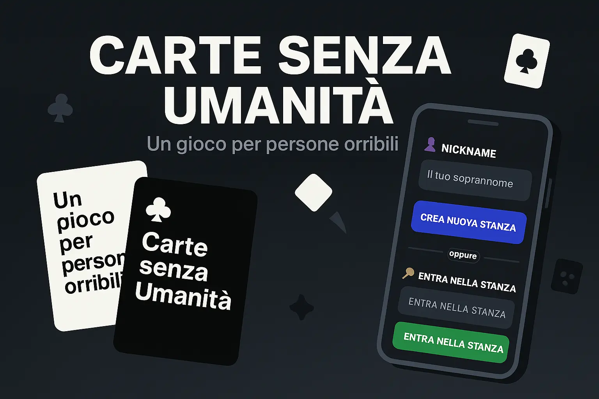

# Carte senza Umanità

An independent, non-commercial Italian-language browser party game for 3–10 players. Create a room, complete outrageous prompts with cards from your hand, and let a rotating judge choose the winning answer.

Built with React, Node.js and Socket.IO, the game brings a familiar fill-in-the-blank card format to shared, real-time browser sessions.

**Content warning:** The Italian card deck includes adult themes, dark humour and potentially offensive material. It is intended for mature players.

> **Unofficial fan project.** Carte senza Umanità is not affiliated with, sponsored by or endorsed by Cards Against Humanity LLC.



## Play online

**[Open Carte senza Umanità](https://carte-senza-umanita.onrender.com/)**

The application is configured to use these Render endpoints:

- **Game interface:** https://carte-senza-umanita.onrender.com/
- **Socket.IO server:** https://carte-senza-umanita-server.onrender.com/

The second URL is the backend service, not another game interface. The client displays a connection or server wake-up message while waiting for the backend. Availability depends on the deployed services and is not guaranteed by the repository.

## How to play

1. **Create or join a room.** Enter a nickname (up to 20 characters). One player creates a room and shares its five-character code; others use that code to join.
2. **Set up the game.** The host starts the match once at least three players have joined. Rooms support up to ten players. The default winning score is **5 points**, and the default hand contains **7 white cards**. The lobby also offers other hand sizes and a configurable winning score.
3. **Play your cards.** Each round presents a black prompt. Every player except the judge chooses the required number of white cards—one, two or three—keeping the selected order for multi-card answers.
4. **Choose a winner.** Once all non-judges have submitted, their answers are shuffled for the judging interface. The judge picks a submission, and its author receives one point.
5. **Continue until someone wins.** The judge of the completed round starts the next round, the judging role passes to the next player, and play continues until someone reaches the target score.

The **host is the first judge**; subsequent judges rotate through the players. New players cannot join a match that has already started.

White-card hands are replenished as cards are played, and used cards can be recycled when a deck runs out.

## Features and architecture

The application has two independently started components:

- **Client:** React 19, Vite 6 and Tailwind CSS provide the Italian-language interface, lobby, game board, scoreboard and light/dark themes.
- **Server:** Node.js, Express 5 and Socket.IO manage rooms, player membership, hands, turns, judges, submissions, scoring and game completion.

The server is authoritative for game state. The browser sends actions and renders updates received over Socket.IO, rather than calculating scores or winners independently.

```text
Browser — React / Vite
        |
        | Socket.IO
        v
Node.js / Express server
        |
        +-- GameManager: rooms and player connections
        |
        +-- Room: cards, rounds, judges and scores
        |
        +-- server/data/: Italian card decks
```

Key socket actions include room creation and joining, starting a match, submitting cards, selecting a winner, advancing rounds, requesting game state and reconnecting.

Room state is held **in server memory**, independently for each active room. There is no database-backed match history or permanent account system.

## Run locally

You need **Node.js and npm**. The repository includes `.node-version` specifying Node.js `20.11.1`; GitHub Actions currently builds and tests with Node.js 22.

Clone the repository and enter its root directory:

```bash
git clone https://github.com/falker47/Carte-senza-Umanita.git
cd Carte-senza-Umanita
```

Install the root, client and server dependencies:

```bash
npm run install-all
```

Start both development servers:

```bash
npm run dev
```

Open:

- **Client:** http://localhost:5173
- **Server:** http://localhost:3001

The repository also includes `dev.sh` and `dev.bat` as development launchers for Unix-like systems and Windows respectively.

### Configuration

For local development, the browser connects to `http://localhost:3001`. The production client uses `VITE_APP_SERVER_URL`, configured in `client/.env.production` to point to the Render backend.

The server listens on the `PORT` environment variable, falling back to `3001`. Its Socket.IO and Express CORS configuration allows the local Vite origin in development and the configured Render frontend origin in production.

If you deploy the components under different public domains, update both the client backend URL and the server's allowed origin. The frontend is built with:

```bash
npm run build
```

The root package also exposes `npm start` to launch the Node.js server.

## Italian card deck

The cards are maintained as JSON files in `server/data/`:

| File | Contents |
|---|---|
| `carte_bianche.json` | 417 answer cards |
| `carte_nere.json` | 234 prompt cards |
| `parole.json` | Words used to generate room codes |

The black-card prompts are divided into **197 one-card**, **33 two-card** and **4 three-card** prompts.

The current white-card array has no duplicate strings; the black-card array has no duplicate prompt texts. These counts describe the checked repository data, not every possible historical or upstream deck.

Cards are selected by shuffling the configured decks for each game room. There is no in-app deck editor or custom-deck upload feature. Changing the deck requires editing the relevant JSON files and restarting the server.

## Card provenance and attribution

Carte senza Umanità contains a mixed Italian fan deck assembled and revised over the project's history. Git commits document additions, removals, rewrites, wording corrections and conversion into the JSON format used by the web game.

The source families identified in the project's provenance documentation include:

- **Cards Against Humanity LLC** — the original game and card material. See the [official Cards Against Humanity website](https://www.cardsagainsthumanity.com/).
- **I Traduttori Mascherati** — the historical Italian translation distributed as `CAH_ita_2.0.pdf`.
- **CaH42project** — Italian fan-expansion material, also referenced in [community-preserved sources](https://github.com/ilario/Cards-Against-Humanity-ITA).
- **falker47 and Carte senza Umanità contributors** — subsequent selection, locally authored additions, rewrites, corrections and application-specific adaptations.

These credits identify relevant source families. They do **not** mean every card came from every listed source.

The available historical notices and repository records support the documented relationship with Creative Commons Attribution–NonCommercial–ShareAlike material. However, the repository does not contain a complete, card-by-card chain of authorship and permissions. Its provenance notes should not be interpreted as independent verification of the rights or origin of every individual card.

The project documents the mixed adapted corpus as distributed under **[CC BY-NC-SA 2.0 IT](https://creativecommons.org/licenses/by-nc-sa/2.0/it/)**. This requires attribution, non-commercial use and share-alike treatment of adaptations within the license's terms.

For the attribution details, modifications and licensing scope, read both:

- [LICENSE-CARDS.md](LICENSE-CARDS.md) — card-corpus license, credits and conditions.
- [CONTENT_NOTICE.md](CONTENT_NOTICE.md) — provenance, changes and the distinction between code and content.

Neither the Creative Commons license nor this repository grants trademark rights or implies an official relationship with Cards Against Humanity LLC.

## Testing and verification

The server has six game-flow tests using Node.js's built-in test runner. They cover:

- Joining rooms, duplicate nicknames and host-only game start.
- The minimum of three players and initial card dealing.
- Card submissions, judge selection and point assignment.
- Reaching the winning score and ending a game.
- Judge rotation and advancing to another round.
- Multi-card submissions and player reconnection.

Run the tests from the repository root:

```bash
cd server
npm test
```

The [GitHub Actions CI workflow](.github/workflows/ci.yml) runs on pull requests and pushes to `main`. It performs two independent jobs:

- **Server tests:** install dependencies and run `npm test`.
- **Client build:** install dependencies and run the production Vite build.

A historical manual smoke test on **21 September 2026** covered a three-player game, including joining, submitting cards, judging, awarding points and continuing to the next round. It is a dated test record, not continuous monitoring of the live deployment.

The automated suite tests the game model with sample card data. It is not a full browser end-to-end test, penetration test or comprehensive security audit.

## Sessions, privacy and limitations

The application is designed for casual games with friends, not authenticated or high-stakes multiplayer sessions.

- **No accounts or passwords.** Players are identified by room code, nickname and the current Socket.IO connection. There is no secure identity verification or recovery token.
- **Reconnection is limited.** The browser saves the nickname, room code and current application view in `localStorage` to attempt rejoining. An existing player can be reassociated with a new socket using the same nickname and room code, but this mechanism is not secure authentication and does not guarantee recovery from every disconnection.
- **Answers are not cryptographically anonymous.** The judging interface displays shuffled submissions, but the game-state payload contains player identifiers associated with those submissions.
- **Matches are temporary.** Rooms, hands, scores and rounds are not stored in a persistent database. Restarting or replacing the server process loses active sessions.
- **Disconnections can interrupt play.** A disconnected participant may remain part of an ongoing match, preventing the round from advancing until they reconnect. Leaving voluntarily can also affect the room or match.
- **Browser and server data.** The client uses browser `localStorage` for its session-related view state and theme preference. The server writes game-related diagnostic information to its logs, including some player identifiers and card data. Do not use sensitive personal information as a nickname.
- **No payment integration.** The repository does not implement advertising, payments or donations.

The server's allowed-origin configuration restricts configured browser origins; it does not replace user authentication or protect a room code as a secret.

## Project structure

```text
.
├── assets/
│   └── preview.webp
├── client/
│   ├── public/
│   └── src/
│       ├── components/
│       └── hooks/
├── server/
│   ├── data/
│   ├── src/
│   │   └── models/
│   └── tests/
├── docs/
├── .github/workflows/ci.yml
├── .node-version
├── dev.sh
├── dev.bat
├── LICENSE
├── LICENSE-CARDS.md
├── CONTENT_NOTICE.md
└── README.md
```

The `docs/` directory also contains a design specification concerning reconnection during a game. A design document describes intended behaviour and should not be treated as proof that all of its proposed changes are implemented.

## Licensing

This repository has **separate licensing scopes**:

- **Repository-authored application source code:** [MIT License](LICENSE).
- **The Italian card corpus** (`server/data/carte_bianche.json` and `server/data/carte_nere.json`): [CC BY-NC-SA 2.0 IT](LICENSE-CARDS.md), with attribution and modification information in [CONTENT_NOTICE.md](CONTENT_NOTICE.md).
- **Third-party material, names and trademarks:** rights remain subject to their respective owners and applicable permissions.

The MIT License does not override the conditions governing the card corpus. The card-corpus licensing declaration likewise does not establish rights in third-party material beyond those actually granted by its rights holders.

Carte senza Umanità is an independent, non-commercial fan project. It is not an official Italian edition of Cards Against Humanity.
